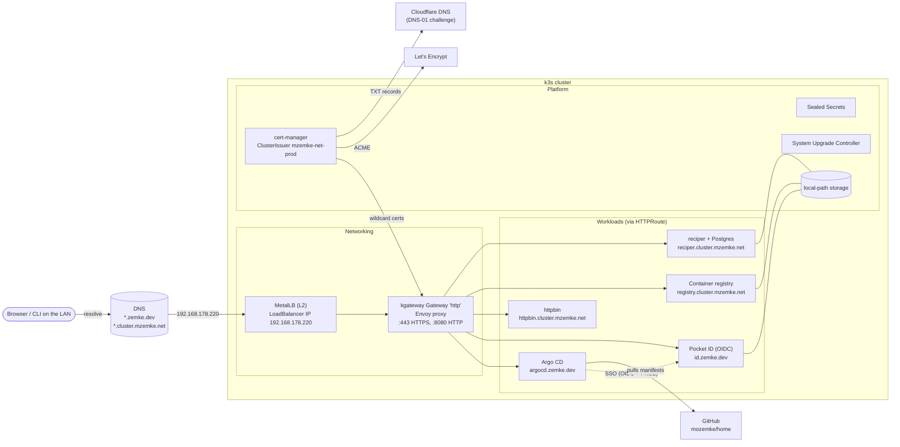
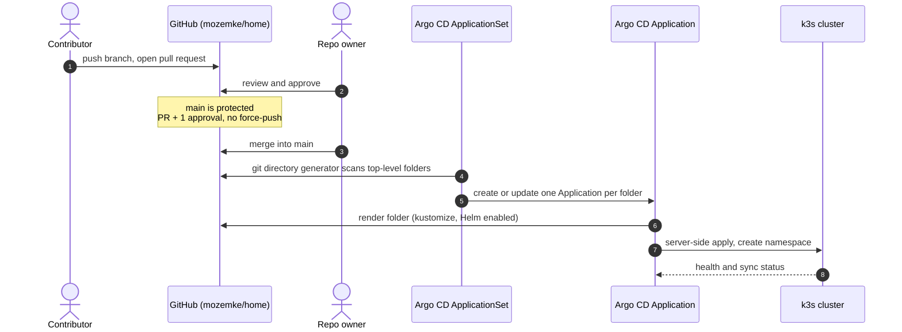
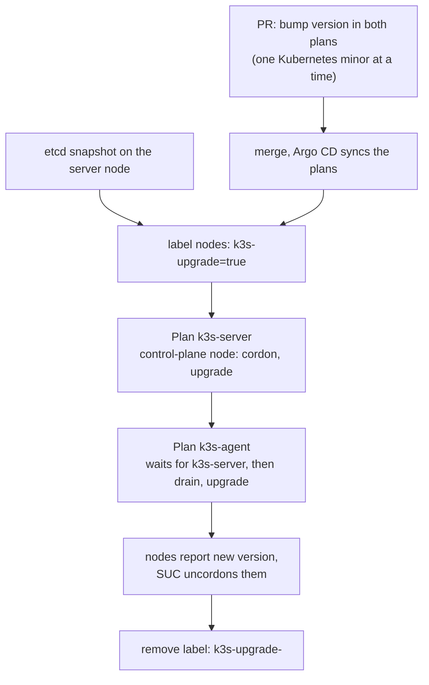

# home

GitOps repository for my homelab: a small k3s cluster whose platform components are deployed by Argo CD from this repo. Every top-level folder is one Argo CD Application.

- [Architecture](#architecture)
- [Cluster](#cluster)
- [Repository layout](#repository-layout)
- [How changes reach the cluster](#how-changes-reach-the-cluster)
- [Traffic, DNS and TLS](#traffic-dns-and-tls)
- [Identity](#identity)
- [Secrets](#secrets)
- [Kubernetes upgrades](#kubernetes-upgrades)
- [Bootstrapping a fresh cluster](#bootstrapping-a-fresh-cluster)
- [Not managed here (yet)](#not-managed-here-yet)
- [Known quirks](#known-quirks)

## Architecture



## Cluster

| | |
|---|---|
| Distribution | [k3s](https://k3s.io), one server node (control plane + embedded etcd) and one agent node |
| OS | Ubuntu 26.04 LTS, containerd |
| Load balancing | MetalLB in L2 mode; the bundled Traefik and ServiceLB are not used |
| Ingress | [kgateway](https://kgateway.dev) implementing the Kubernetes Gateway API |
| Storage | `local-path` (default StorageClass): node-local volumes, not replicated |
| Kubernetes version | target lives in [`system-upgrade-controller/plan.yaml`](system-upgrade-controller/plan.yaml) |

## Repository layout

The versions below are what the folders pin today; the kustomization files are the source of truth.

| Folder | What | Namespace | Pinned version |
|---|---|---|---|
| [`app/`](app/) | The ApplicationSet that turns every other folder into an Application (applied by hand, not by itself) | `argocd` | – |
| [`argocd/`](argocd/) | Argo CD (manages itself), HTTPRoute, Pocket ID SSO, custom UI styles | `argocd` | v3.6.1 |
| [`cert-manager/`](cert-manager/) | cert-manager and the `mzemke-net-prod` ClusterIssuer (Let's Encrypt, Cloudflare DNS-01) | `cert-manager` | v1.20.2 |
| [`kgateway/`](kgateway/) | Gateway API CRDs, kgateway, the `http` Gateway and its TLS certificates | `kgateway-system` | kgateway v2.5.1, Gateway API v1.7.0 |
| [`metallb/`](metallb/) | MetalLB (native mode), address pool `sandbox` (`192.168.178.220/32`), L2 advertisement | `metallb-system` | v0.16.2 |
| [`sealed-secrets/`](sealed-secrets/) | Sealed Secrets controller | `sealed-secrets` | v0.41.2 (chart 2.22.0) |
| [`system-upgrade-controller/`](system-upgrade-controller/) | System Upgrade Controller, Plan CRD, k3s upgrade plans | `system-upgrade` | v0.21.0 |
| [`httpbin/`](httpbin/) | go-httpbin test service and route | `httpbin` | – |
| [`registry/`](registry/) | In-cluster container registry (no auth, LAN only) | `registry` | registry 2.8.3 |

Dependency updates are proposed by [Renovate](renovate.json).

## How changes reach the cluster



- The ApplicationSet ([`app/appset.yaml`](app/appset.yaml)) uses a git directory generator: each top-level folder (except `app/`) becomes an Application with the folder name as app name and default namespace.
- Folders are rendered with kustomize; Helm charts are inflated through kustomize `helmCharts` (`kustomize.buildOptions: --enable-helm` in `argocd-cm`).
- Sync options: `ServerSideApply=true` (required since Argo CD 3.3 because the ApplicationSet CRD is too large for client-side apply) and `CreateNamespace=true`. Whether syncs run automatically is configured in the same file.
- Resources whose CRD is installed in the same sync carry `argocd.argoproj.io/sync-options: SkipDryRunOnMissingResource=true`, and where order matters a `sync-wave`.
- `app/` is not part of the generator: changes to the ApplicationSet must be applied by hand (`kubectl apply -n argocd -f app/appset.yaml`).

## Traffic, DNS and TLS

All HTTP(S) traffic enters through one Gateway:

1. DNS for `*.zemke.dev` and `*.cluster.mzemke.net` points to `192.168.178.220`.
2. MetalLB announces that address on the LAN (L2) for the Gateway's LoadBalancer Service. The pool contains only this one address, so the Gateway always gets it.
3. The kgateway Envoy proxy terminates TLS and routes by host name through `HTTPRoute`s.

| Listener | Port | Hostnames | Certificate (Secret) |
|---|---|---|---|
| `http` | 8080 | any | – |
| `https` | 443 | `*.cluster.mzemke.net` | `wildcard` |
| `https-dev` | 443 | `*.zemke.dev` | `wildcard-dev` |

| Host | Service | Route defined in |
|---|---|---|
| `argocd.zemke.dev` | Argo CD | [`argocd/httproute.yaml`](argocd/httproute.yaml) |
| `id.zemke.dev` | Pocket ID | not in this repo yet |
| `httpbin.cluster.mzemke.net` | httpbin | [`httpbin/httproute.yaml`](httpbin/httproute.yaml) |
| `registry.cluster.mzemke.net` | container registry | [`registry/registry.yaml`](registry/registry.yaml) |
| `reciper.cluster.mzemke.net` | reciper | not in this repo yet |

Certificates are issued by cert-manager through the `mzemke-net-prod` ClusterIssuer (Let's Encrypt, ACME DNS-01 via Cloudflare) and live next to the Gateway in [`kgateway/certificates.yaml`](kgateway/certificates.yaml): `*.cluster.mzemke.net`, `*.zemke.dev` and the apex `zemke.dev`.

## Identity

[Pocket ID](https://pocket-id.org) (`id.zemke.dev`) is the OIDC provider (passkeys).

- Argo CD signs in directly against Pocket ID (`oidc.config` in [`argocd/argocd-cm.yaml`](argocd/argocd-cm.yaml)): public client with PKCE, no client secret. Redirect URI: `https://argocd.zemke.dev/auth/callback`.
- Everyone who can sign in through Pocket ID is admin in Argo CD (`policy.default: role:admin`); who may sign in is controlled in Pocket ID.
- The built-in Argo CD `admin` account stays enabled as a fallback when Pocket ID is down.

## Secrets

No plaintext secrets in this repo. Two mechanisms:

**Sealed Secrets** for everything committed to git:

```sh
# online, through the API server
kubeseal --controller-namespace sealed-secrets -o yaml < secret.yaml > sealed-secret.yaml

# offline, with the public certificate
kubeseal --controller-namespace sealed-secrets --fetch-cert > pub-cert.pem
kubeseal --cert pub-cert.pem -o yaml < secret.yaml > sealed-secret.yaml
```

The controller's private sealing key must be backed up outside git; without it, a rebuilt cluster cannot decrypt anything:

```sh
kubectl -n sealed-secrets get secret -l sealedsecrets.bitnami.com/sealed-secrets-key -o yaml > sealing-key-backup.yaml
```

**Applied by hand on bootstrap** (not yet sealed): the Cloudflare API token that cert-manager uses for DNS-01.

```yaml
apiVersion: v1
kind: Secret
metadata:
  name: cloudflare-api-token-secret
  namespace: cert-manager
type: Opaque
stringData:
  api-token: xxxxxx
```

## Kubernetes upgrades

k3s is upgraded in place by the [System Upgrade Controller](https://github.com/rancher/system-upgrade-controller) with two Plans in [`system-upgrade-controller/plan.yaml`](system-upgrade-controller/plan.yaml):



1. `sudo k3s etcd-snapshot save --name pre-<version>` on the server node.
2. Merge the version bump and let Argo CD sync the `system-upgrade-controller` app.
3. `kubectl label node <server> <agent> k3s-upgrade=true`
4. Watch `kubectl get nodes -w` and `kubectl -n system-upgrade get plans,jobs`.
5. `kubectl label node <server> <agent> k3s-upgrade-`

The label is the safety gate: Plans only touch labelled nodes. If labels stay on, every merged version bump starts an upgrade immediately. Never skip a minor version and never set a version lower than the nodes run.

During an upgrade the API server is briefly unavailable (single control-plane node), and workloads with `local-path` volumes on the drained node are down until it is back.

## Bootstrapping a fresh cluster

1. Install k3s with Traefik and ServiceLB disabled (`--disable traefik --disable servicelb`), MetalLB provides LoadBalancer IPs.
2. Apply the Cloudflare token Secret (see [Secrets](#secrets)) and, if restoring, the Sealed Secrets key backup *before* the controller starts.
3. Install Argo CD: `kubectl kustomize --enable-helm argocd | kubectl apply --server-side --force-conflicts -f -` (server-side apply is required for the ApplicationSet CRD).
4. Apply the ApplicationSet: `kubectl apply -n argocd -f app/appset.yaml`. From here Argo CD deploys every folder, including itself.
5. Register `https://argocd.zemke.dev/auth/callback` as redirect URI of the Argo CD client in Pocket ID.

## Not managed here (yet)

Running in the cluster but deployed outside this repo:

| What | Namespace | Notes |
|---|---|---|
| Pocket ID | `pocket-id` | OIDC provider, `local-path` volume |
| reciper | `reciper` | app image from the in-cluster registry, Postgres 17 StatefulSet |
| Grafana Cloud monitoring | `monitoring` | Alloy, kube-state-metrics, node-exporter, Beyla (Helm) |

## Known quirks

- The ApplicationSet sets each app's default namespace to its folder name and creates it, so folders whose resources live elsewhere leave an empty namespace behind (`kgateway`, `metallb`, `system-upgrade-controller`).
- The `Plan` CRD is shipped explicitly in `system-upgrade-controller/` because upstream's kustomize base does not contain it (the controller only registers it at startup).
- All persistent data sits on node-local `local-path` volumes without replication.
